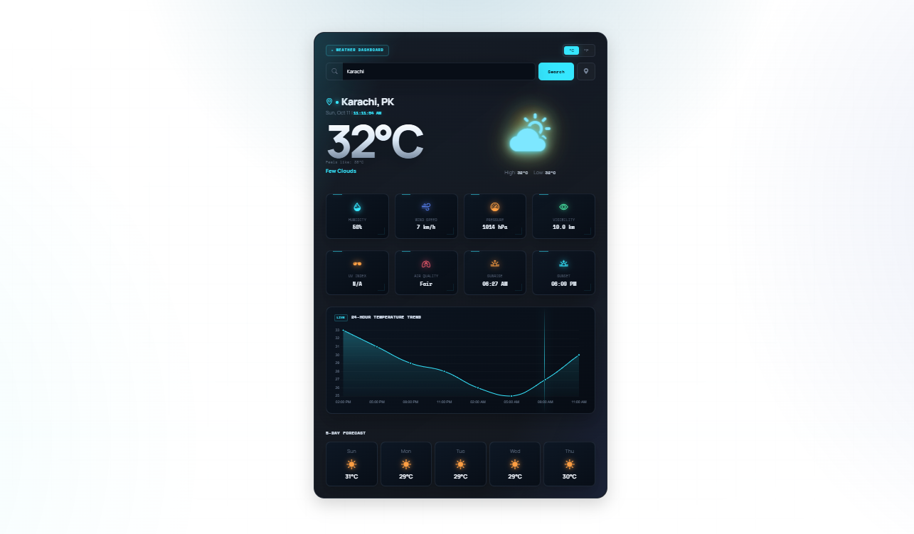

# 🌦️ Weather Website

A modern, responsive weather website featuring a clean dark interface, current weather conditions, detailed weather metrics, temperature trends, and a 5-day forecast.

## ✨ Features

- 🌍 Search for weather by city
- 🌡️ Display current temperature and weather conditions
- 💧 Show humidity and wind speed
- 🌬️ Display atmospheric pressure and visibility
- 🌅 Sunrise and sunset information
- 📈 Temperature trend chart
- 📅 5-day weather forecast
- 🌡️ Celsius/Fahrenheit unit selection
- 📍 Location-based weather lookup (if supported)
- 📱 Responsive design for different screen sizes
- 🎨 Modern dark-themed user interface

## 🛠️ Technologies Used

- HTML5
- CSS3
- JavaScript (ES6+)
- Weather API
- Responsive Web Design

## 📸 Screenshot



## 📂 Project Structure

```text
Weather-App/
├── index.html
├── style.css
├── script.js
├── screenshot.png
└── README.md
```

## 🚀 Getting Started

### 1. Clone the repository

```bash
git clone https://github.com/muhammadahmad152/weather-dashboard.git
```

### 2. Open the project

```bash
cd weather-dashboard
```

### 3. Run the website

Open `index.html` in your browser, or use the **Live Server** extension in Visual Studio Code.

## 🧠 What I Learned

- Working with JavaScript and DOM manipulation
- Fetching and processing API data
- Updating weather information dynamically
- Handling user input and search functionality
- Displaying weather metrics and forecast data
- Building responsive layouts with CSS
- Improving frontend UI/UX

## 🌐 Live Demo

[View Weather Website](https://muhammadahmad152.github.io/weather-dashboard/)

## 👨‍💻 Author

**Muhammad Ahmad Khan**

- GitHub: [@muhammadahmad152](https://github.com/muhammadahmad152)

## ⭐ Feedback

If you have suggestions or ideas for improving this project, feel free to share your feedback!

---

*Built as part of my frontend development journey.*
